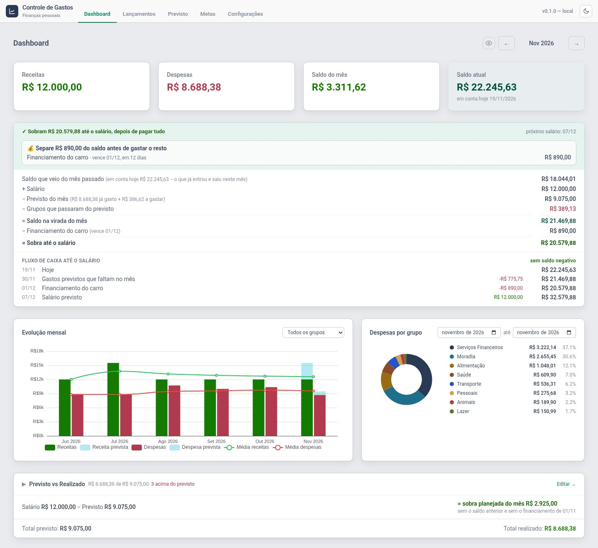
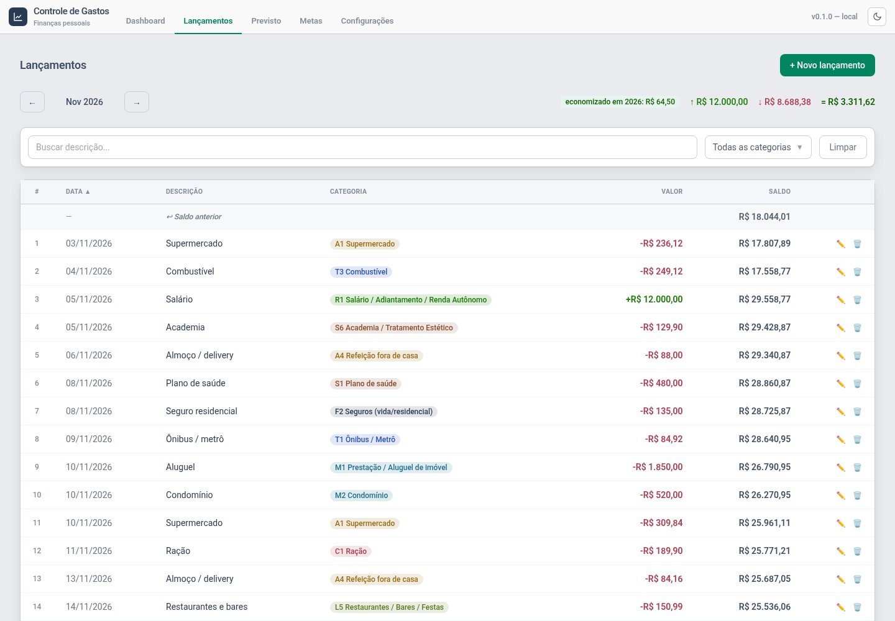
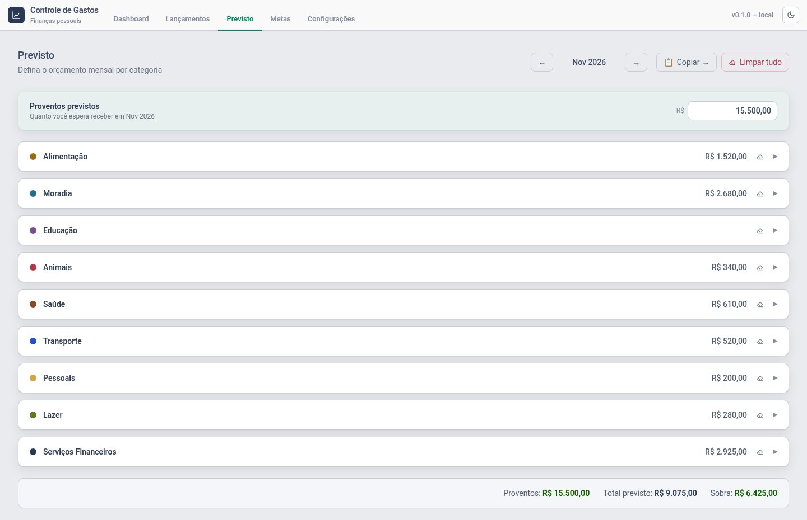
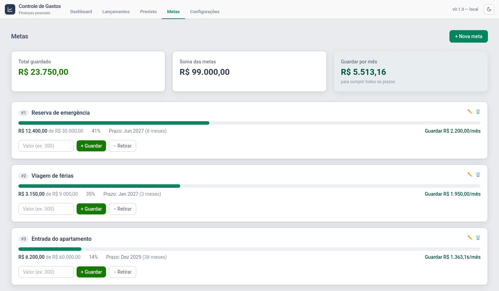
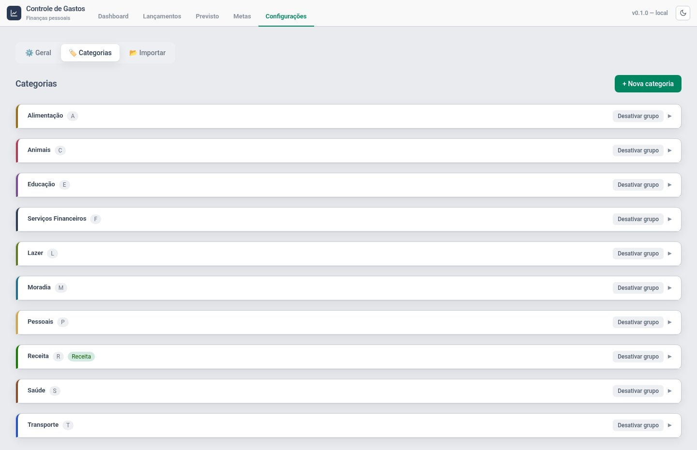
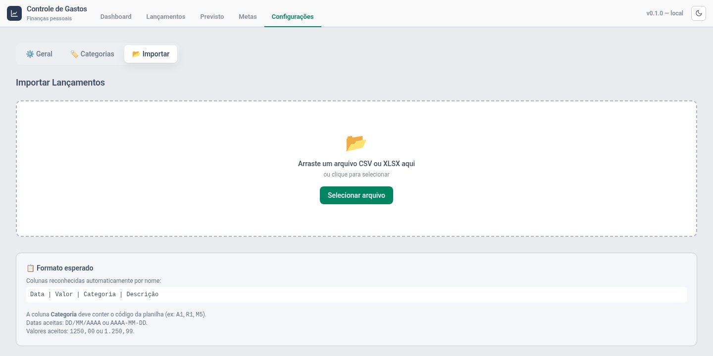

# Controle de Gastos

Aplicação pessoal de controle financeiro: categoriza receitas e despesas, projeta orçamento mensal e acompanha metas financeiras.

## Funcionalidades

- **Dashboard** com visão consolidada por mês, saldo atual, fluxo de caixa até o próximo salário e gráficos (ECharts).
- **Transações**: lançamento manual, edição e categorização.
- **Categorias e grupos**: organização de receitas/despesas por grupo (ex. Moradia, Alimentação, Transporte).
- **Orçamento previsto** por categoria e mês, com receita prevista e cópia de um mês para outro.
- **Metas financeiras**: reserva, viagem, imóvel, com progresso e quanto guardar por mês para cumprir o prazo.
- **Antecipação de parcelas**: registra o desconto obtido ao pagar antes do vencimento.
- **Importação** de extratos (CSV/XLSX), com parsing de datas e valores em formato brasileiro.

## Screenshots

| Dashboard | Lançamentos |
| --- | --- |
|  |  |

| Previsto | Metas |
| --- | --- |
|  |  |

| Categorias | Importação |
| --- | --- |
|  |  |

Os dados das capturas são fictícios.

## Stack

- [SvelteKit 2](https://svelte.dev/docs/kit) + [Svelte 5](https://svelte.dev/docs/svelte) + TypeScript
- [Drizzle ORM](https://orm.drizzle.team/) + SQLite (`better-sqlite3`)
- [Tailwind CSS 4](https://tailwindcss.com/)
- [ECharts](https://echarts.apache.org/) para gráficos
- [Vitest](https://vitest.dev/) para testes unitários

## Rodando localmente

Pré-requisitos: Node 20+.

```sh
npm install
cp .env.example .env
```

Edite o `.env`:

```
DATABASE_URL=local.db
```

Aplique o schema no banco e (opcionalmente) popule categorias padrão:

```sh
npm run db:push
npm run db:seed
```

Inicie o servidor de desenvolvimento:

```sh
npm run dev
```

## Scripts

| Comando            | Descrição                                    |
| ------------------- | --------------------------------------------- |
| `npm run dev`       | Servidor de desenvolvimento                   |
| `npm run build`     | Build de produção                             |
| `npm run preview`   | Preview do build                              |
| `npm run test`      | Roda a suíte de testes (Vitest)               |
| `npm run test:watch`| Testes em modo watch                          |
| `npm run check`     | Type-check (svelte-check)                     |
| `npm run lint`      | Prettier + ESLint                             |
| `npm run db:studio` | Abre o Drizzle Studio para inspecionar o banco |

## Estrutura

```
src/
  lib/
    server/
      db/          schema, seed, acesso a dados
    utils/         funções puras (formatação, parsing)
    components/    componentes Svelte reutilizáveis
  routes/
    api/           endpoints REST (import)
    dashboard, transactions, previsto, metas, settings (geral, categorias, importar)
```
